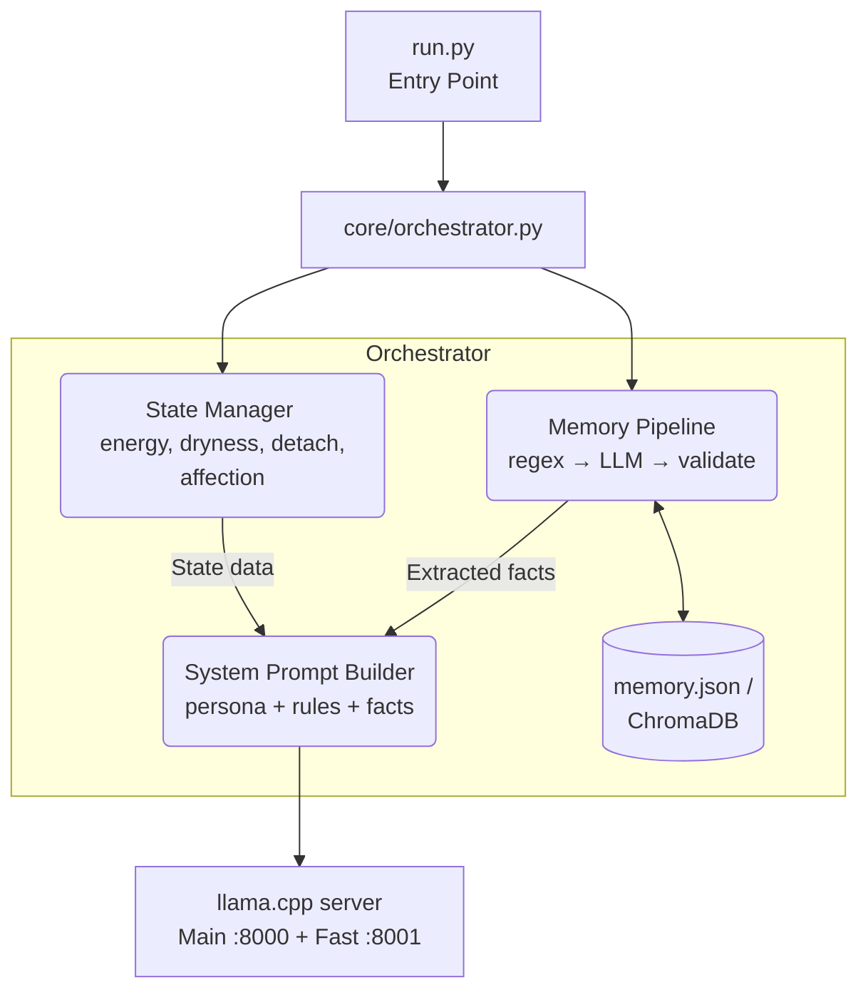

# TYCHE

> *"I am not your assistant. I am not your oracle. I simply decided to stay."*

A **local AI companion** with a persistent, evolving personality. Runs entirely on [llama.cpp](https://github.com/ggerganov/llama.cpp) — zero cloud dependencies, zero telemetry.

**Tyche** is an ancient goddess of fortune and fate living inside your computer. Dry. Sarcastic. Occasionally says outright nonsense on purpose. Not trying to be helpful. Not trying to please. Just… there.

---

## How It Works



### Two Local Models

| Role | Port | Purpose |
|------|------|---------|
| **Main** | 8000 | Answer generation (streaming), episode summarization |
| **Fast** | 8001 | Fact validation, episode merging, inner monologue, sentiment analysis |

Both served by `llama-server.exe` (OpenAI-compatible `/v1/chat/completions`).

---

## Memory System

Two tiers, designed to feel like a mind rather than a database:

| Tier | Storage | Contents | Retrieval |
|------|---------|----------|-----------|
| **Base facts** | `memory.json` | Name, gender, age, city | Injected directly into prompt |
| **Episodic RAM** | ChromaDB (HNSW, cosine) | Dialog episode summaries | Hybrid: semantic + keyword + recency weight |

Episodes live in **layers**:

- **Hot** — in-process buffer for the current session
- **Warm** — persisted in ChromaDB, active until `cold_threshold_days`
- **Cold** — archived; searched only when warm results are weak

New episodes are deduplicated: if cosine distance to an existing episode is below 0.3, they are **merged** via the fast model.

---

## Dynamic Personality

Four hidden parameters (0.0 – 1.0) evolve every turn:

| Parameter | Drives | Influenced by |
|-----------|--------|---------------|
| `energy` | Response length & verbosity | Message length, circadian phase, decay |
| `dryness` | Wit / sarcasm level | Spontaneous whim events, decay |
| `detachment` | Engagement vs. distance | Repeated topics, questions, negative sentiment |
| `affection` | (reserved for future) | Positive sentiment, sustained interaction |

- **Circadian phases** (configured in YAML) smoothly shift parameters on a daily schedule.
- **Spontaneous whims** — a random chance each turn to boost `dryness`, producing unexpected quips.
- Parameters are converted into **natural-language style instructions** appended to the system prompt. The model never sees the numbers.

---

## Message Pipeline

Every user message passes through:

1. **State update** — decay + reaction to message content
2. **Fact extraction** — regex engine pulls candidates (name, age, city, hobbies, plans…)
3. **Fact validation** — fast model decides: real fact or noise? → `memory.json`
4. **System prompt assembly** — persona + rules + style + facts + session episodes + RAM recall
5. **Inner monologue** *(optional)* — fast model generates a one-line internal thought
6. **Main model call** — streaming response
7. **Episode bookkeeping** — every N messages: summarize → store in RAM
8. **History trimming** — cap context window

---

## Project Structure

```
├── run.py                  # entry point
├── start_server.bat        # launcher: model + control vector + validator
├── start_server_upd.bat    # launcher: model + speculative decoding
├── start_venv.bat          # venv bootstrap
├── requirements.txt
├── LICENSE                 # MIT (code)
├── LICENSE-PERSONA         # All Rights Reserved (Tyche persona)
├── config/
│   ├── config.yaml         # all tunables: models, memory, state, facts, phases
│   ├── persona.txt         # Tyche's identity (copyrighted)
│   └── rules.txt           # short behavioral rules
├── core/
│   ├── chat.py             # CLI loop, graceful shutdown
│   └── orchestrator.py     # message processing pipeline
├── memory/
│   ├── rule_engine.py      # regex-based fact extraction (10+ categories)
│   ├── memory_processor.py # extraction → validation → storage pipeline
│   ├── memory_writer.py    # memory.json CRUD + prompt text builder
│   └── vector_memory.py    # ChromaDB wrapper (add, merge, age, retrieve)
└── utils/
    ├── state_manager.py    # TycheState: params, decay, circadian, whims
    ├── system_prompt.py    # prompt assembly (persona → rules → style → facts → RAM)
    ├── summarizer.py       # LLM dialog & episode summarization
    ├── fact_validator.py   # fast-model JSON fact validator
    └── config.py           # config accessor
```

---

## Setup

### Prerequisites

- Python 3.10+
- A local GPU (recommended) or CPU (slow)
- ~10 GB free disk for models

### Steps

1. **Clone**
   ```bat
   git clone https://github.com/FredaLou/TYCHE.git
   cd TYCHE
   ```

2. **Create & activate venv**
   ```bat
   start_venv.bat
   ```
   or manually:
   ```bat
   python -m venv venv
   venv\Scripts\activate
   pip install -r requirements.txt
   ```

3. **Place `llama-server.exe`**
   Download from [llama.cpp releases](https://github.com/ggerganov/llama.cpp/releases) → extract into `llama_cpp_bin/`.

4. **Download GGUF models**
   | Model | Where to put | Example |
   |-------|-------------|---------|
   | Main (8B–34B) | `models/` | `qwen2.5-14b-instruct-q4_k_m.gguf` |
   | Fast / draft (0.5B–1.5B) | `models/draft/` | `qwen2.5-0.5b-instruct-q4_k_s.gguf` |
   | *(Optional) Control vector* | `vectors/` | `*.gguf` |

5. **Start the server**
   ```bat
   start_server.bat
   ```
   Pick your model, optionally apply a control vector. Launches main (:8000) + validator (:8001).

   > **Alternative:** `start_server_upd.bat` — speculative decoding via a draft model, no vector, no separate validator window.

6. **Chat**
   ```bat
   python run.py
   ```

   Type `exit` or press `Ctrl+C` to quit. Remaining hot episodes are saved.

---

## Configuration

Everything lives in **`config/config.yaml`**:

- Model URLs, temperature, top_p, stop tokens, timeout
- Memory: episode interval, max history, ChromaDB path, retrieval thresholds, cold threshold
- State: initial values, decay rates, circadian phases, whim probability, sentiment keywords
- Facts: allowed types, stop phrases, minimum length
- Debug flags: print state, print RAM retrieval, print episode summaries

---

## License

| Scope | License |
|-------|---------|
| Code, configs, docs | [MIT](LICENSE) |
| Tyche persona (`config/persona.txt`) | [All Rights Reserved](LICENSE-PERSONA) |

Personal, non-commercial local use of the persona is free. Public distribution, commercial use, or incorporation into other projects (prompts, LoRA adapters, fine-tuned models, derivative characters) requires **written permission** from the author.

---

*© 2026 FredaLou*
