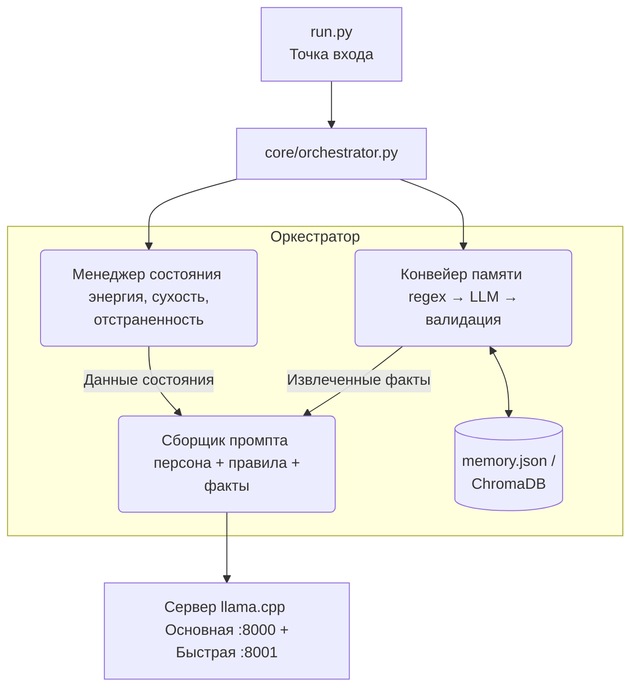

[English](README.md) | **Русский**

# TYCHE

**Локальный ИИ-компаньон** с постоянной, развивающейся личностью. Работает полностью на [llama.cpp](https://github.com/ggerganov/llama.cpp) — никаких облачных зависимостей, никакой телеметрии.

**Ти́ха (Tyche)** — древняя богиня удачи и судьбы, живущая внутри твоего компьютера. Сухая. Саркастичная. Иногда намеренно говорит откровенную чушь. Не пытается быть полезной. Не пытается угодить. Просто… существует.

---

## Как это работает



### Две локальные модели

| Роль | Порт | Назначение |
|------|------|------------|
| **Main** | 8000 | Генерация ответов (стриминг), суммаризация эпизодов |
| **Fast** | 8001 | Валидация фактов, слияние эпизодов, внутренний монолог, тональность |

Обе обслуживаются `llama-server.exe` (OpenAI-совместимый `/v1/chat/completions`).

---

## Система памяти

Два уровня, спроектированные как память, а не база данных:

| Уровень | Хранилище | Содержимое | Поиск |
|---------|-----------|------------|-------|
| **Базовые факты** | `memory.json` | Имя, пол, возраст, город | Прямая инъекция в промпт |
| **Эпизодная RAM** | ChromaDB (HNSW, cosine) | Суммари диалоговых эпизодов | Гибрид: семантика + ключевые слова + вес давности |

Эпизоды живут в **слоях**:

- **Горячий** — буфер текущей сессии (в памяти процесса)
- **Тёплый** — сохранён в ChromaDB, активен до `cold_threshold_days`
- **Холодный** — архив; ищется только если тёплый слой дал слабый результат

Новые эпизоды дедуплицируются: если косинусная дистанция до существующего эпизода < 0.3, они **сливаются** через быструю модель.

---

## Динамический характер

Четыре скрытых параметра (0.0 – 1.0) эволюционируют каждый ход:

| Параметр | Влияет на | Зависит от |
|----------|-----------|------------|
| `energy` | Длина и развёрнутость ответа | Длина сообщения, суточная фаза, затухание |
| `dryness` | Уровень остроумия / сарказма | Спонтанные всплески, затухание |
| `detachment` | Вовлечённость vs отстранённость | Повторы тем, вопросы, негативная тональность |
| `affection` | (зарезервировано) | Позитивная тональность, продолжительность общения |

- **Суточные фазы** (конфигурируются в YAML) плавно сдвигают параметры по расписанию.
- **Спонтанные всплески** — случайный шанс каждый ход повысить `dryness`, порождая неожиданные реплики.
- Параметры конвертируются в **стилистические инструкции** на естественном языке и добавляются в системный промпт. Модель никогда не видит числа.

---

## Пайплайн сообщения

Каждое сообщение пользователя проходит через:

1. **Обновление состояния** — затухание + реакция на содержимое
2. **Извлечение фактов** — regex-движок тянет кандидатов (имя, возраст, город, хобби, планы…)
3. **Валидация фактов** — быстрая модель решает: реальный факт или шум? → `memory.json`
4. **Сборка системного промпта** — persona + rules + стиль + факты + эпизоды сессии + RAM-вспоминания
5. **Внутренний монолог** *(опционально)* — быстрая модель генерирует одну внутреннюю мысль
6. **Вызов основной модели** — стриминговый ответ
7. **Учёт эпизодов** — каждые N сообщений: суммаризация → сохранение в RAM
8. **Обрезка истории** — ограничение контекстного окна

---

## Структура проекта

```
├── run.py                  # точка входа
├── start_server.bat        # лаунчер: модель + control vector + валидатор
├── start_server_upd.bat    # лаунчер: модель + speculative decoding
├── requirements.txt
├── LICENSE                 # MIT (код)
├── LICENSE-PERSONA         # All Rights Reserved (персона Тихе)
├── config/
│   ├── config.yaml         # весь конфиг: модели, память, состояние, факты, фазы
│   ├── persona.txt         # личность Тихе (авторское право)
│   └── rules.txt           # короткие поведенческие правила
├── core/
│   ├── chat.py             # CLI-цикл, graceful shutdown
│   └── orchestrator.py     # пайплайн обработки сообщения
├── memory/
│   ├── rule_engine.py      # regex-извлечение фактов (10+ категорий)
│   ├── memory_processor.py # конвейер: извлечение → валидация → запись
│   ├── memory_writer.py    # CRUD memory.json + сборка текста для промпта
│   └── vector_memory.py    # ChromaDB (добавление, слияние, старение, поиск)
└── utils/
    ├── state_manager.py    # TycheState: параметры, затухание, суточные фазы, всплески
    ├── system_prompt.py    # сборка промпта (persona → rules → стиль → факты → RAM)
    ├── summarizer.py       # LLM-суммаризация диалога и эпизодов
    ├── fact_validator.py   # валидатор фактов быстрой моделью (JSON)
    └── config.py           # доступ к конфигу
```

---


## 🗺️ Roadmap / Дорожная карта

To see what's coming next, current known issues, and our development plans, please check out the full Roadmap.

Чтобы узнать о планах на будущее, текущих проблемах и этапах разработки, ознакомьтесь с нашей Дорожной картой.

➡️ **[English Roadmap (ROADMAP.md)](ROADMAP.md)**
➡️ **[Русская дорожная карта (ROADMAP_RU.md)](ROADMAP_RU.md)**


## Установка

### Предварительные требования

- Python 3.10+
- Локальный GPU (рекомендуется) или CPU (медленно)
- ~10 ГБ свободного места для моделей

### Шаги

1. **Клонировать**
   ```bat
   git clone https://github.com/FredaLou/TYCHE.git
   cd TYCHE
   ```

2. **Создать и активировать venv**
   ```bat
   python -m venv venv
   venv\Scripts\activate
   pip install -r requirements.txt
   ```

3. **Положить `llama-server.exe`**
   Скачать из [releases llama.cpp](https://github.com/ggerganov/llama.cpp/releases) → распаковать в `llama_cpp_bin/`.

4. **Скачать GGUF-модели**
   | Модель | Куда положить | Пример |
   |--------|---------------|--------|
   | Основная (8B–34B) | `models/` | `qwen2.5-14b-instruct-q4_k_m.gguf` |
   | Быстрая / draft (0.5B–1.5B) | `models/draft/` | `qwen2.5-0.5b-instruct-q4_k_s.gguf` |
   | *(Опционально) Control vector* | `vectors/` | `*.gguf` |

5. **Запустить сервер**
   ```bat
   start_server.bat
   ```
   Выбрать модель, при желании применить control vector. Запускает main (:8000) + validator (:8001).

   > **Альтернатива:** `start_server_upd.bat` — speculative decoding через draft-модель, без вектора и отдельного окна валидатора.

6. **Чат**
   ```bat
   python run.py
   ```

   Ввести `exit` или нажать `Ctrl+C` для выхода. Оставшиеся горячие эпизоды будут сохранены.

---

## Конфигурация

Всё в **`config/config.yaml`**:

- URL моделей, температура, top_p, стоп-токены, таймаут
- Память: интервал эпизодов, макс. история, путь ChromaDB, пороги поиска, холодный порог
- Состояние: начальные значения, коэффициенты затухания, суточные фазы, шанс всплеска, ключевые слова тональности
- Факты: разрешённые типы, стоп-фразы, минимальная длина
- Debug-флаги: печатать состояние, печатать RAM-поиск, печатать суммаризацию эпизодов

---

## Лицензия

| Область | Лицензия |
|---------|----------|
| Код, конфиги, документация | [MIT](LICENSE) |
| Персона Тихе (`config/persona.txt`) | [All Rights Reserved](LICENSE-PERSONA) |

Личное некоммерческое локальное использование персоны — бесплатно. Публичное распространение, коммерческое использование или встраивание в другие проекты (промпты, LoRA-адаптеры, дообученные модели, производные персонажи) требует **письменного разрешения** автора.

---

*© 2026 FredaLou*
